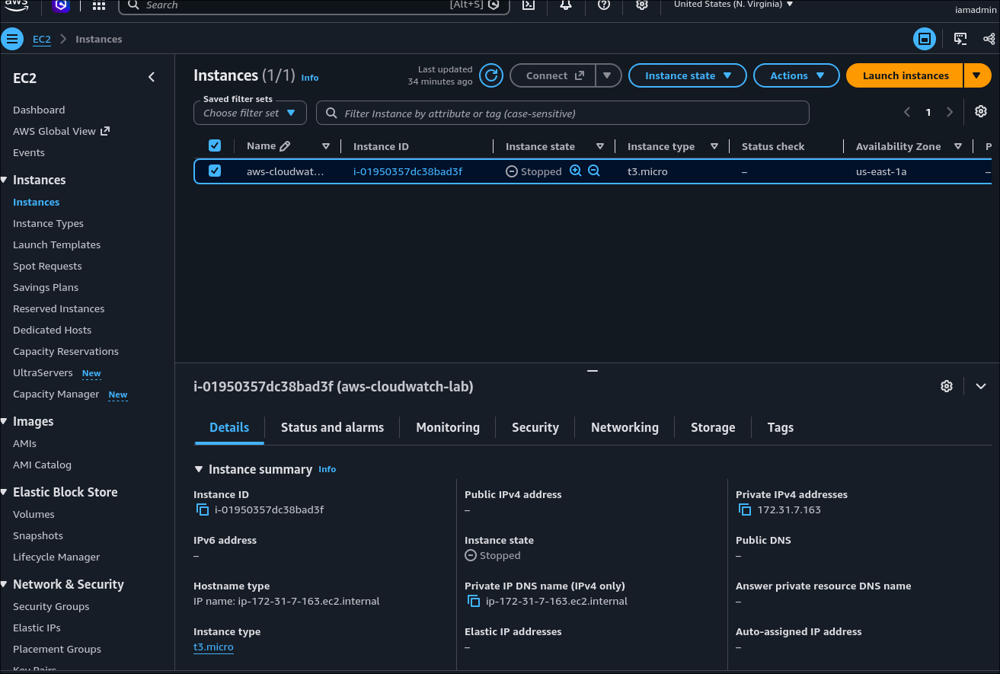
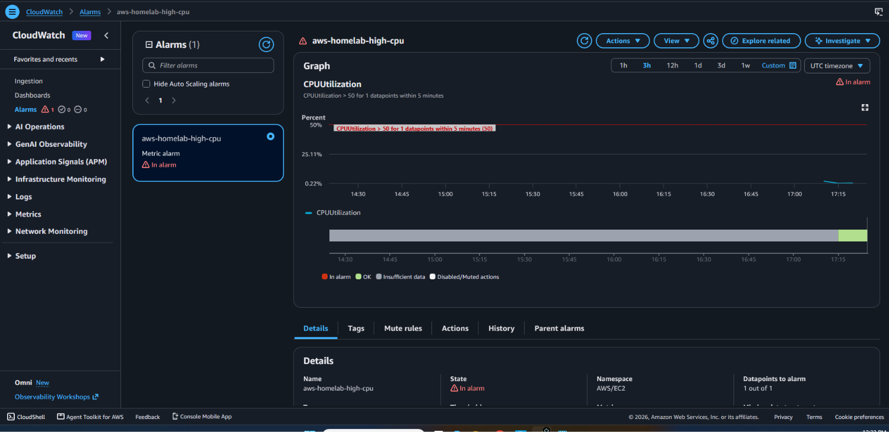

# AWS EC2 Monitoring with CloudWatch and SNS

## Project Overview

Built and tested an AWS infrastructure monitoring solution
using Amazon EC2, Amazon CloudWatch, and Amazon SNS.

The project demonstrates Linux administration, cloud
monitoring, secure remote access, incident detection,
and automated email alerting.

## Architecture

Amazon EC2 (Amazon Linux 2023)
    |
    +-- IAM Role / Systems Manager
    |
    +-- CloudWatch CPUUtilization
              |
              v
       CloudWatch Alarm
          CPU > 50%
              |
              v
          Amazon SNS
              |
              v
       Email Notification

## AWS Services Used

- Amazon EC2
- Amazon CloudWatch
- Amazon SNS
- AWS Identity and Access Management (IAM)
- AWS Systems Manager Session Manager
- Amazon EBS

## Infrastructure

- Region: us-east-1 (N. Virginia)
- Instance: t3.micro
- Operating System: Amazon Linux 2023
- Storage: 8 GiB encrypted gp3 EBS volume
- Remote Access: AWS Systems Manager Session Manager
- Security Group: No inbound rules

## Monitoring and Alerting

Configured a CloudWatch alarm with:

- Metric: CPUUtilization
- Threshold: Greater than 50%
- Evaluation period: 5 minutes
- Datapoints to alarm: 1 out of 1
- Notification: Amazon SNS email

## Testing and Results

Installed stress-ng and generated CPU load on EC2.

CloudWatch detected elevated CPU utilization and
triggered the configured alarm.

An SNS email notification was successfully received,
validating the end-to-end monitoring workflow.

## Screenshots

### EC2 Instance

### CloudWatch CPU Alarm

## Documentation

- [Architecture](docs/architecture.md)
- [Testing and Validation](docs/testing.md)

## Security Practices

- Used IAM instance role permissions.
- Connected through Systems Manager instead of SSH.
- Configured no inbound security group rules.
- Used encrypted EBS storage.

## Cost Management

Stopped the EC2 instance after testing to reduce
compute charges. Storage and other AWS resources
may continue to incur charges.

## Key Skills Demonstrated

AWS EC2 | Linux | CloudWatch | SNS | IAM |
Systems Manager | Infrastructure Monitoring |
Incident Detection | Troubleshooting | Git

## Project Status

Completed and validated.
